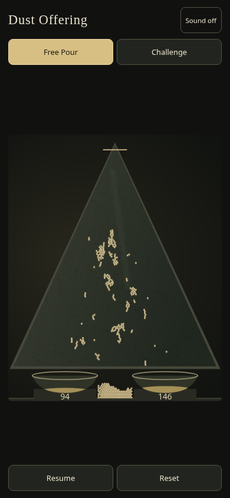
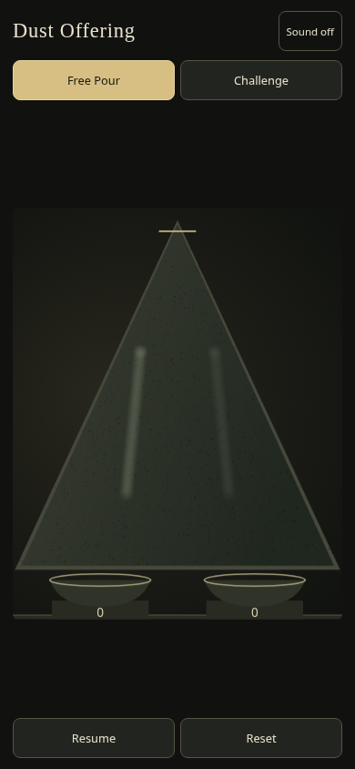
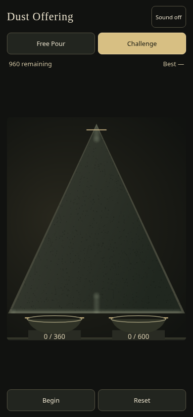

> Historical fixed-source `stone-offering-v3` evidence. The offscreen drifting source is documented in the [current status](../../status.md).

# Downhill traces and full-stone playtest

> Retained 0.4.0 material baseline, including that revision's appearance. The 0.5.0 visual pass keeps this physical model; see [visual-style.md](../../visual-style.md) for the current palette, greasy marks and screenshots.

Revision 0.4.0 addresses the owner's screenshot and feedback: brushing now reaches the whole visible triangle, traces fade noticeably sooner, slopes loosely guide falling sand, the inlet resists a permanent cap, and the pour is 50% wider. Slow motion, one brush action, independent multi-touch and literal bottom piles remain.

## Real-time simulated play

The scripted player uses actual elapsed browser time, without accelerating the frame clock. Raw evidence: [stone-playtest-report.json](../../../artifacts/archive/stone-v3/stone-playtest-report.json). This run used Node 24.22.1 and Linux headless Chromium 156 with a 390 × 844 emulated-touch viewport. Physical-phone feel and human enjoyment still need the owner's evaluation.

| Observation                                  | Result                                                                              |
| -------------------------------------------- | ----------------------------------------------------------------------------------- |
| Gather for 25 seconds                        | 159 attached grains: 36 on stone, 123 on sand                                       |
| Pause, then brush slowly                     | Attachments fell to 124; emission stayed fixed at 605 grains                        |
| Settle for 16 seconds                        | 220 attached grains and 144 resting ground grains; no grains left above y=60        |
| Accounting after settling                    | 94 left + 146 right + 365 retained = 605                                            |
| Two independent traces                       | Strength 0.956 each, zero coating between paths; both remained after lifting        |
| Two extra passes on the left                 | Left strength 2.481; untouched right strength 0.766                                 |
| Six seconds later                            | Left strength 1.231; right strength 0.380, visibly dimmer                           |
| Seven-grain slope control after four seconds | Mean position moved from (70,80) to (86.90,139.53); all seven grains remained loose |
| Browser JavaScript errors                    | None                                                                                |






The slope control uses an actual three-pass brush gesture, then seeds seven grains with a downward velocity. Adhesion is disabled in this isolated scene so the observed lateral motion measures directional grip. The grains drift through a broad corridor rather than locking to a line. Normal material capture is exercised separately in Free Pour and the challenge.

## Inlet drainage and challenge

The real-time challenge pours all 960 grains in 40.01 seconds without any source-clearing strokes. After the settling period, it finishes with 129 left, 172 right, 144 on the ground and 515 above the bowls, scoring 313. This is a drainage/accounting check, not an optimized score attempt. At 10, 20 and 30 seconds, the tip holds approximately 43–44 moving grains rather than a growing attached cap.

Three seeded two-minute numerical pours complement the real-time run. Compared with the actual 0.3.0 source, the 60-second count near the tip falls by about 78%, and the upper-area count falls about 71% on average. Some accumulation still develops farther down the stone, where it is part of the shaping mechanic. All current runs emit and account for 2,880 grains without brushing. Details and raw controls are in [physics-results.md](physics-results.md).

The artificial 6,000-grain retained fixture averages 20.57 ms per frame (about 49 FPS), with 33.4 ms at the 95th percentile on this cloud machine. A brush pointer sequence takes 65.4 ms and releases 46 grains without deleting material. This fixture deliberately pins its upper bonds until brushed to measure retained load; natural weathering is tested in the flowing scenes. Large retained loads still need a physical-device performance check.

## Verification and reproduction

The suite contains 38 numerical/unit checks and 19 browser scenarios across emulated phone and desktop. Three desktop duplicates of touch-only cases are skipped. New coverage includes the tip, all edges and bottom rim; sparse strokes ending outside the triangle; visible six-second decay; guidance from an actual pointer stroke; reverse-direction and crossing slopes; horizontal drainage; upper-bond expiry; waking unsupported loose sand; and two-minute unattended emission. Existing multi-touch, conservation, piles, challenge/storage/sharing, sound, resize and hidden recovery checks remain.



```sh
npm ci
npm run check
npm run test:physics
npx playwright install chromium
npm run test:browser
```

Start Vite with `npm run dev`, then run `npm run playtest` in another terminal for the real-time player. It takes roughly two minutes and updates `artifacts/stone-*`. Use `PLAYWRIGHT_CHROMIUM_EXECUTABLE=/usr/bin/chromium` for a system browser. Earlier [0.3.0 evidence](../stone-v2/playtest.md) remains archived.

For the next human pass, brush right through the bottom rim, watch one untouched trace for six seconds, and compare one pass with several passes on a diagonal. Try both uphill and downhill finger travel on the same slope. Assess whether guidance feels rough enough, fading is apparent, and the wider source stays calm near the tip.
