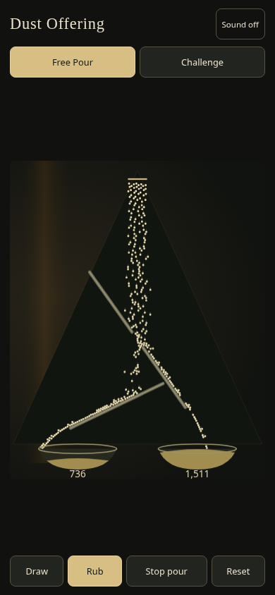

# Gameplay test and handoff

Play at <https://dust-offering.sirsean.me>. Free Pour opens with a live stream. The initial playtest prompt is: **“Get some dust into both bowls while the stream is running.”**

Draw a ridge with a finger, pen, or mouse. Select Rub and drag along a ridge to widen a cut. Stop pour only pauses new emission; existing dust keeps moving. Reset clears the current mode. Challenge allows drawing before Begin, then supplies exactly 4,800 grains for the 1,800 / 3,000 targets. There is no countdown or time penalty. When the source empties, keep editing to rescue dust, then Finish. Sound is optional and starts muted. Desktop shortcuts: D, R, and Space.

## What was exercised

Linux headless Chromium 156, Node 24.22.1, a 390 × 844 touch-enabled viewport and a 1280 × 800 desktop viewport. Additional layout checks cover 320 × 568, 360 × 640, 768 × 1024, and 844 × 390. Pointer tests use actual browser mouse events and emulated touch events, including fast strokes and touch cancellation. **No physical phone, pen, speaker, or human participant was available.**

The browser suite covers a blank face, live drawing/rubbing, widening while pouring, Stop/Resume with dust in flight, full challenge exhaustion, Finish, saved best and reload, failed clipboard/manual sharing, storage denial, sound opt-in/mute, repeated mode switches, resize/rotation, source/bowl edit protection, hidden-tab recovery, and reduced decorative motion. Pure tests also cover native-share success/cancellation, clipboard success/failure, all specified scoring cases, deterministic replay, the physics gate, and grain accounting.

## Real-time simulated gameplay

The reproducible browser player is `scripts/playtest.js`. It uses real elapsed time rather than accelerating the simulation. Its report is [playtest-report.json](../artifacts/playtest-report.json).

It draws a main ridge from (50,70) to (110,155) and a corrective ridge from (96,140) to (38,168). With the main ridge intact, all measured collected grains went right. A short rub from (78,109.667) to (80.884,113.752) opened a live split. Extending it to (82.038,115.386) visibly widened that split.

| Real-time observation                | Result                                       |
| ------------------------------------ | -------------------------------------------- |
| Intact ridge sample                  | 0 left / 242 right, no spill                 |
| Small-cut sample                     | 212 left / 264 right, 44.54% left, no spill  |
| Wider-cut sample                     | 292 left / 185 right, 61.22% left, 2 spilled |
| Full active challenge pour           | 4,800 emitted in 40.05 wall-clock seconds    |
| Challenge result using the small cut | 2,204 left / 2,596 right, 831/1000           |
| Challenge uncollected                | 0 spilled, 0 on the face                     |
| Browser JavaScript errors            | None                                         |



The result is mechanically promising: the first edit has an immediate visible effect, a larger cut causes a measurable further change, and the finite challenge rewards a correction to the same geometry. The stream keeps moving through edits and the controls do not require a hold gesture at the source. That supports the intended tactile loop. Whether people want another pour still needs a human test; automated play cannot establish that response.

## Retained-pile limit

The stress fixture holds 6,000 grains inside a container, with no spill or performance deletion. On this cloud CPU, rendering is roughly 25 FPS near that cap, with occasional 50 ms frames. Direct pointer dispatches selecting Rub completed in 29–46 ms in the retained measurement (33–49 ms in a separate run). Locator-based automation takes longer because it also waits for layout stability; the retained report records direct pointer round trips. A strict 60 FPS guarantee on phone hardware is not established.

Resting particles may sleep, but the deliberately extreme fixture remained active. An edit wakes all grains, so a rubbed support cannot leave frozen dust suspended. The fixed-step work budget preserves input at the cap by allowing simulation time to slow under load. Normal challenge play uses far fewer retained particles and the measured active pour stayed within 0.05 seconds of the planned 40 seconds.

## Reproduce locally

```sh
npm ci
npx playwright install chromium
npm run check
npm run test:browser
```

The browser test command starts Vite if necessary. For the real-time simulated player, first start `npm run dev`, then run `npm run playtest`. To remeasure only the stress scene while preserving the existing full-run report, use `npm run playtest -- --stress-only`. On a machine with a system Chromium, set `PLAYWRIGHT_CHROMIUM_EXECUTABLE=/usr/bin/chromium` instead of downloading a browser. Physics measurements are `npm run test:physics`.

## Human evaluation next

Give the free-play prompt without showing the coordinates above. Watch whether the player discovers a split, corrects it without coaching, and keeps experimenting after succeeding. Then try Challenge. Priorities for tuning are Rub sensitivity under a thumb, the width range that feels controllable, whether a 3:5 target is motivating, sound level on real speakers, and frame rate with a large catch on actual phones. Change the challenge identifier if published physics or scoring conditions change.
