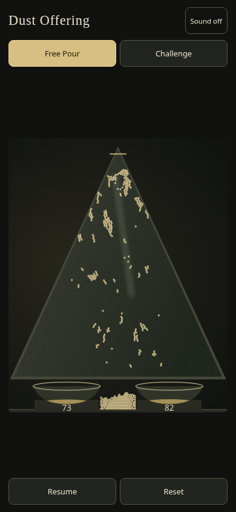
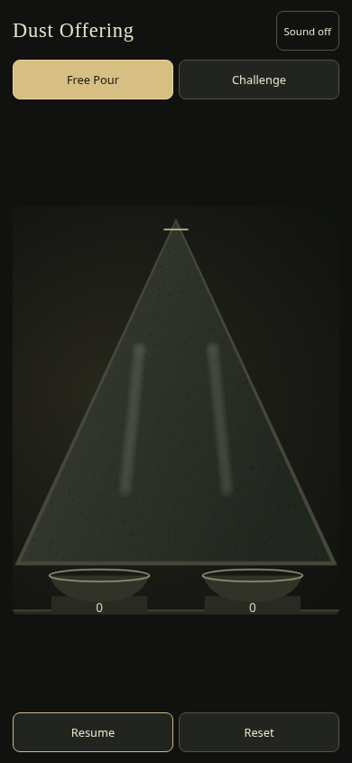
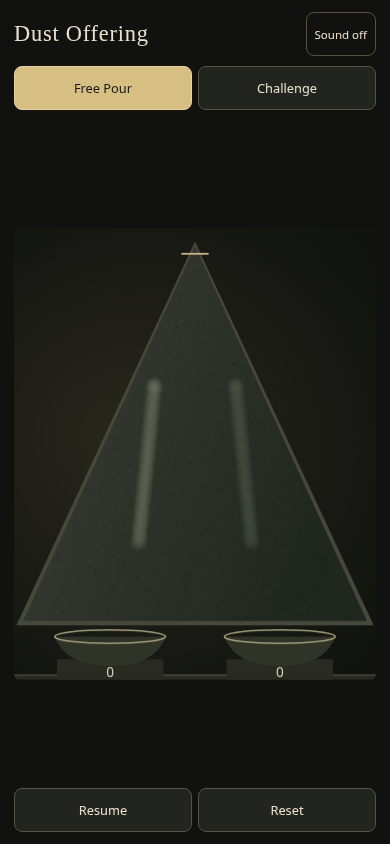

# Sticky traces and multi-touch playtest

Revision 0.3.0 keeps the slow sand-on-stone interaction and adds a lasting surface trace. Brush with one or more fingers, a pen or mouse. The light sage coating catches later sand more readily; another pass strengthens and brightens it. Coating fades gradually, while brushing continues to push and release existing deposits. There is one action and no tool selection.

## Real-time simulated play

The scripted player used actual elapsed browser time, without an accelerated clock. Raw evidence: [stone-playtest-report.json](../artifacts/stone-playtest-report.json). Testing used Node 24.22.1 and headless Chromium 156 on Linux, with a 390 × 844 emulated-touch viewport. No physical phone or human participant was available.

| Observation                                               | Result                                                                                |
| --------------------------------------------------------- | ------------------------------------------------------------------------------------- |
| Gather for 25 seconds                                     | 204 attached grains: 42 on stone, 162 on sand                                         |
| One slow brush stroke                                     | Attached count fell to 155; all grains accounted for                                  |
| Resting ground grains immediately before / after brushing | 62 / 62                                                                               |
| Settle for 16 seconds with the pour paused                | 270 attached, 160 resting ground grains; 605 emitted unchanged                        |
| Accounting after settling                                 | 73 left + 82 right + 450 retained = 605                                               |
| Two fingers on fresh stone                                | Two active contacts; separate paths of strength 0.961 each, zero coating between them |
| Lift both fingers                                         | Both traces remained visible; zero active contacts                                    |
| Two additional passes on the left                         | Strength 2.797 on the left, 0.919 on the untouched right                              |
| Six seconds later                                         | Left strength faded to 2.430; right to 0.798                                          |
| Browser JavaScript errors                                 | None                                                                                  |







The traces remain visible without the contact circles, and the stronger pass reads clearly as a brighter coating beneath the sand. The source and bowl mouths remain protected. Material release is immediate while the subsequent fall remains slow. These responses support another human gameplay test; automated play does not establish how relaxing or tactile it feels on real hardware.

## Challenge and retained-material load

The optional `stone-offering-v2` challenge keeps 960 grains, targets 360 / 600 and no countdown or time penalty. Three short source-clearing strokes accompanied a 40.14-second active pour. After settling, 135 grains were left, 179 right, 213 on the ground and 433 above the bowls, scoring 327. This verifies completion and conservation, rather than an optimized scoring strategy.

The 6,000-grain retained fixture averaged 21.78 ms per frame (about 46 FPS), with 33.4 ms at the 95th percentile on this cloud machine. A direct brush sequence took 86.6 ms and released 46 grains without deleting any. This extreme fixture remains slower than ordinary play and needs a physical-device performance check.

## Automated checks and reproduction

There are 32 numerical/unit tests and 15 passing browser scenarios across phone and desktop; three desktop duplicates of touch-only cases are skipped. Trace checks cover rendered pixel changes after lifting, brighter stacking, 30-second half-life, reduced-motion visibility, Reset, actual faster stone capture, sparse/dense event dosing and fully decayed behavior. Chrome touch injection checks two simultaneous paths, overlap, partial lift while another finger continues, cancellation, and Reset during a two-finger gesture. Existing checks cover slow accumulation, release cascades, persistent ground piles, challenge/storage/sharing, sound, layout, source/bowl protection and hidden/resize recovery.

```sh
npm ci
npm run check
npm run test:physics
npx playwright install chromium
npm run test:browser
```

For the real-time player, start Vite with `npm run dev`, then run `npm run playtest` in another terminal. It takes roughly two minutes and refreshes `artifacts/stone-*`. `npm run playtest -- --stress-only` remeasures the retained face while preserving the full-run report. A system browser can be selected with `PLAYWRIGHT_CHROMIUM_EXECUTABLE=/usr/bin/chromium`.

For the next human pass, layer several strokes, watch new sand catch along the brighter path, and try brushing with two fingers. Evaluate whether the trace is legible beneath sand, whether the 30-second half-life feels gentle, and whether independent fingers feel natural. Earlier [0.2.0 evidence](archive/stone-v1/playtest.md) is retained separately.
