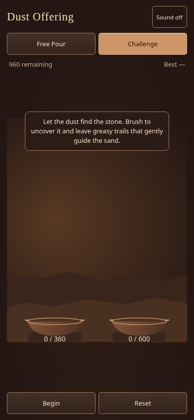
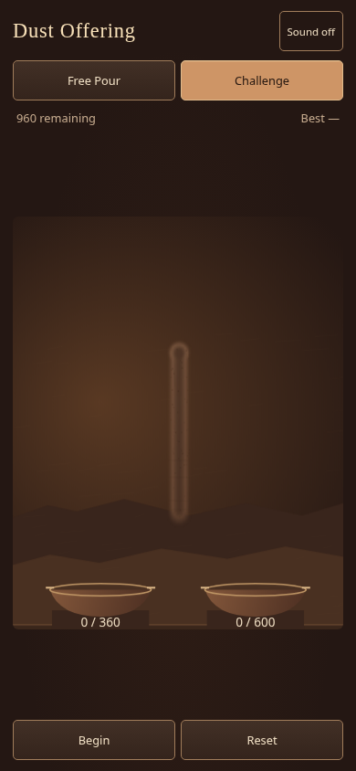
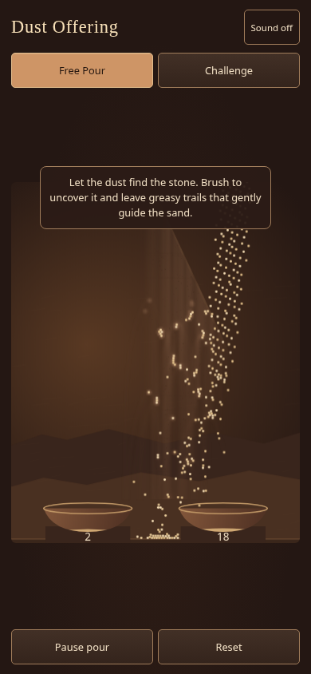

# Discovering the stone — playtest

Revision 0.7.0 starts with the whole stone invisible. Fingers and grains progressively reveal the areas they touch, with repeated contact exposing more. Discovery persists independently of fading grease. The offscreen drifting opening, slow sand, desert palette and downhill guides remain in place.

## Real-time simulated play

The scripted player watches a 45-second uninterrupted pour in actual browser time, then pauses, brushes, and lets material settle. Raw evidence: [stone-playtest-report.json](../artifacts/stone-playtest-report.json). The run used Node 24.22.1 and Linux headless Chromium 156 at 390 × 844 with emulated touch; no physical phone was used.

| Observation                           | Result                                                       |
| ------------------------------------- | ------------------------------------------------------------ |
| Source near 15 seconds                | x=123.99; 364 grains emitted; 1,377 visible-cell equivalents |
| Source near 30 seconds                | x=78.77; 726 emitted; 3,062 visible-cell equivalents         |
| Source near 45 seconds                | x=36.03; 1,088 emitted; 5,625 visible-cell equivalents       |
| Offscreen grains during the pour      | 14 at each sample, retained and accounted for                |
| Attached sand before / after brushing | 372 / 360                                                    |
| Paused emission                       | 1,093 grains before and after brushing/settling              |
| After 16 seconds of settling          | 219 left + 234 right + 640 retained = 1,093                  |
| Missed sand after settling            | 210 real grains resting on the ground                        |
| Source during the paused sequence     | Continued drifting to x=92.20 without emitting grains        |
| Browser JavaScript errors             | None                                                         |

The moving ribbon gradually uncovers a faint, uneven path, then exposes stronger patches where sand gathers. At 15 seconds only 74 cells are fully revealed; at 45 seconds 1,748 are, with a much wider partially visible area. A visible-cell equivalent sums each cell's fractional visibility; it is not a count of wholly exposed cells. Brushing gives a stronger immediate reveal while releasing and pushing existing sand. Missed grains remain visible. Automated play verifies these responses; real-finger feel remains for the owner's evaluation.

## Visual discovery

The browser checks compare pixels at the untouched tip, sides, base and interior with the cached landscape. They match exactly: there is no initial outline, shadow or stone texture. Brushing reveals only its local strip. Repeated passes deepen it to full visibility, with soft edges. Ninety seconds later the grease is gone but discovery is unchanged. Resize, hidden recovery and reduced motion preserve it; Reset restores the original empty landscape. These captures use accelerated fixed simulation time in headless Chromium:

| Initially hidden                                                        | Repeated brushing                                                          |
| ----------------------------------------------------------------------- | -------------------------------------------------------------------------- |
|  |  |

The isolated sand-contact check holds one real grain on the stone. Its local visibility starts below 0.1 and reaches one after sustained contact; the rest stays invisible and no grease is created. See [grain-only reveal](../artifacts/stone-grain-reveal.png) and [edge coverage](../artifacts/stone-edges.png).

The following captures come from the real-time pour, without brushing. The initial discovery hint is still visible. Sand reveals the stone along actual paths and deposits, while untouched areas blend into the landscape:

| About 15 seconds                                                          | About 45 seconds                                                                |
| ------------------------------------------------------------------------- | ------------------------------------------------------------------------------- |
|  |  |

Additional real-time evidence: [30 seconds](../artifacts/stone-sand-30s.png), [after brushing and settling](../artifacts/stone-after.png), [two fingers](../artifacts/stone-traces.png), [layered reveal](../artifacts/stone-layered-traces.png) and [six seconds later](../artifacts/stone-faded-traces.png).

## Challenge, guidance and load

The unattended `stone-offering-v5` challenge emits all 960 grains in 40.01 real seconds. After settling it finishes with 134 left, 228 right, 199 on the ground and 399 above the bowls, scoring 377. This checks completion and conservation, rather than an optimized score. Earlier scores remain isolated under their previous identifiers.

The two-finger phase leaves independent revealed strips and grease marks, with no connecting coating between them. Two extra passes raise the left trace from strength 0.956 to 2.485; six seconds later it falls to 1.233 while discovery stays exactly unchanged. In the isolated seven-grain guide control, mean position moves from (70,80) to (86.75,139.03) in four seconds, with all grains still loose.

The deliberately pinned 6,000-grain fixture averages 20.72 ms per frame (about 48 FPS), with 33.4 ms at the 95th percentile. A brush sequence takes 67.1 ms and releases 46 grains without losing material. This is a cloud-machine load check, not a physical-device benchmark.

## Verification and reproduction

All 48 numerical/unit tests and 25 browser scenarios pass. Three desktop duplicates of touch-only cases are skipped. New coverage verifies initial invisibility, local additive finger and sand exposure, continuous paths and all edges, two independent fingers, persistence after grease fades, preparation/Begin/resize/hidden/reset lifecycle, and deterministic discovery. A paired numerical check proves the reveal does not change particle physics, source timing or accounting. Existing sand, source, grease, pile and challenge checks remain.

```sh
npm run check
npm run test:physics
PLAYWRIGHT_CHROMIUM_EXECUTABLE=/usr/bin/chromium npm run test:browser
```

With Vite running, `npm run playtest` refreshes the real-time evidence and takes about two and a half minutes. Browser discovery checks save their captures in the transient report. Prior fully visible stone evidence is retained in [archive/stone-v4/](archive/stone-v4/playtest.md); the palette baseline remains in [visual-style.md](visual-style.md).
