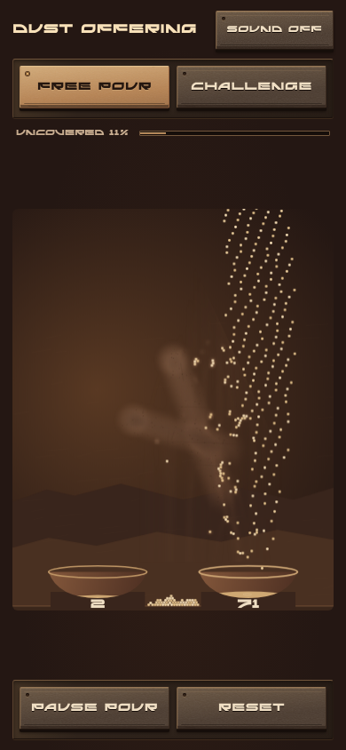
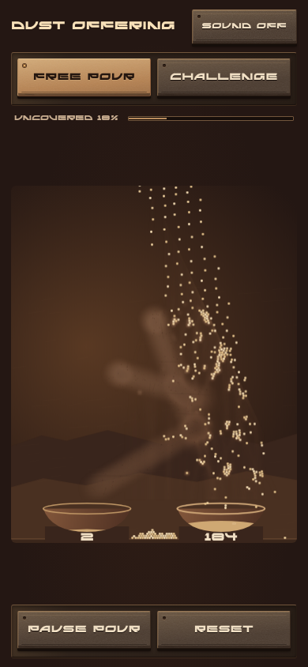
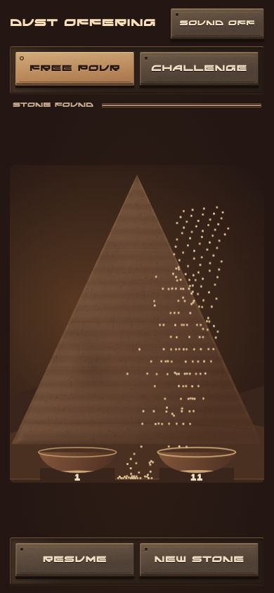

# Tactile playthrough and load review

> Historical revision 0.10.0 baseline. Current fine-dust behavior and performance are in [fine-dust.md](fine-dust.md).

Revision 0.10.0 / `stone-offering-v7` improves the physical brush and the free-play loop while retaining the quiet desert direction. The design comparison and rejected trials are in [gameplay-review.md](gameplay-review.md).

## Real-time native emulated touch

Several sessions used headless Chromium 156 at 390 × 844 with native emulated touch, real browser time and the same gesture plan. No physical phone or human participant was used. The frozen 0.9.0 baseline catches no material on its opening diagonal swipe; the selected prepared scene moves 38 grains and releases ten. Its first physical response is recorded about 32 ms into that gesture, including dispatch/path timing rather than a pure rendering-latency benchmark.

The selected session performs initial diagonals, a stream crossing, a scoop, two independent fingers, a slow curve, paused-pour reshaping and an opted-in sound sweep. It ends with 888 emitted = 80 left + 293 right + 515 retained, including 140 misses. The source has advanced nine preparation seconds plus actual play time, so final collection totals must not be compared directly with the cold baseline's shorter physical age. Matched active/idle simulations provide the causal comparison instead.

The audio phase records 23 material-contact texture events and eight bowl tones, with measured signal peak 0.02465 on a normalized scale where clipping begins at one. Muting suspends the context and clears contact sound. This establishes functioning quiet signal and cleanup, not subjective audio quality.

Silent first-twelve-second recordings: [before](../artifacts/gameplay-review/before.webm), [after](../artifacts/gameplay-review/after.webm). Full gesture/state records: [baseline](../artifacts/gameplay-review/baseline/report.json), [selected](../artifacts/gameplay-review/final/report.json).

| Opening selected play                                                                      | A later scoop                                                                    |
| ------------------------------------------------------------------------------------------ | -------------------------------------------------------------------------------- |
|  |  |

## A quiet purpose

A scripted uncovering pattern reaches the 82% goal after 36.8 simulation seconds in each of three seeds. At 42 seconds it has about 99% coverage; passive play has about 17–20%. The goal is reachable and primarily driven by brushing, without a countdown. “Stone found” and “New stone” do not end play or discard the creation. This remains a human design hypothesis: completion may give useful purpose or may feel like a cleaning task.

[Goal-on/off layout captures and fresh-stone results](../artifacts/gameplay-review/goal/report.json) accompany [narrow](../artifacts/gameplay-review/goal/narrow.png), [landscape](../artifacts/gameplay-review/goal/landscape.png) and [desktop](../artifacts/gameplay-review/goal/desktop.png) views.

## Isolated full playthrough

The refreshed `npm run playtest` report is [stone-playtest-report.json](../artifacts/stone-playtest-report.json). It observes 45 real seconds of the prepared shower, then pauses, targets a real deposit and settles:

| Observation                                 | Result                                                                |
| ------------------------------------------- | --------------------------------------------------------------------- |
| Brush release                               | 47 actual bond releases; attached count 374 → 342                     |
| Paused pour after settling                  | 294 left + 244 right + 624 retained = 1,162 emitted                   |
| Ground material                             | 184 real resting grains                                               |
| Layered left grease, then six seconds later | 2.544 → 1.260, with discovery unchanged in the isolated empty scene   |
| Seven-grain sloping-guide control           | Mean (70,80) → (92.36,138.09) in four seconds; all seven remain loose |
| Unattended challenge                        | All 960 grains in 45.98 real seconds; final score 430                 |
| Challenge accounting                        | 169 left + 244 right + 156 ground + 391 face = 960                    |
| Retained 6,000-grain fixture                | 20.98 ms mean frame, 33.4 ms at the 95th percentile                   |
| Large-fixture tap                           | 71.4 ms, releasing 126 grains; all 6,000 remain accounted for         |
| Browser JavaScript errors                   | None                                                                  |

The load check runs separately from other CPU-heavy reviews. It is a cloud-machine measurement, not a phone benchmark. Ordinary and reduced-motion browser scenarios preserve actual sand, grease, discovery and piles. The retained-material cap never deletes particles.

## Reproduction and limits

All 63 numerical/unit tests and 33 browser scenarios pass; three desktop duplicates of touch-only cases are skipped. Coverage includes first-use material, no hint, local reveal, goal/reset, sparse/dense and stationary input, independent touches, collection response, opt-in/mute/hidden sound, full supply, mass, scoring/sharing, layout and hidden recovery. The Web Audio mute assertion waits for the audio rendering quantum rather than assuming synchronous parameter readback.

Run `npm run check`, `npm run test:browser` and `npm run test:physics`. With Vite running, `npm run playtest` refreshes the isolated real-time/load evidence. For recorded native-touch review, install Playwright's ffmpeg and run `node scripts/feel-playtest.js http://127.0.0.1:5173 candidate`; system Chromium can be selected with `PLAYWRIGHT_CHROMIUM_EXECUTABLE`. In a restricted environment use a writable `PLAYWRIGHT_BROWSERS_PATH` for ffmpeg.

Observed improvements are immediacy, material reach, directional control, feedback and a completion opportunity. Human enjoyment, desire for another swipe, long-session interest and repeat visits have not been measured. The next playtest should decide those questions directly rather than treating automated success as enjoyment.
