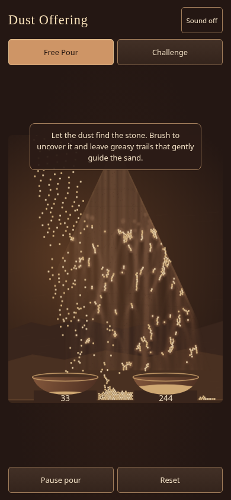

# Wider, uneven pour — playtest

Revision 0.8.0 widens the offscreen aperture to 34 logical units and gives the stream slow swells, smaller ripples and occasional brief sputters. The opening still sways gently, grains retain their slow motion, and fingers and sand continue discovering the hidden stone.

## Real-time simulated play

The scripted player observes 45 seconds of uninterrupted flow, then pauses, brushes, checks two-finger discovery and grease decay, completes a challenge and exercises a 6,000-grain fixture. Raw evidence is in [stone-playtest-report.json](../artifacts/stone-playtest-report.json). The run uses Node 24.22.1 and Linux headless Chromium 156 at 390 × 844 with emulated touch; no physical phone is used.

The player records each fixed step's births and rate during the opening sequence. It verifies that actual birth positions span over 30 units, one-second emission counts include both quiet and busy periods, and there are real brief gaps during sputters. Default flow emits at most one grain per step. The rate stays below 44 grains/s; no paused or blocked emission is saved up for a later burst.

| Measured observation                        | Result                                                |
| ------------------------------------------- | ----------------------------------------------------- |
| Actual birth coverage across the aperture   | 32.75 units across its 34-unit width                  |
| Quietest / busiest complete seconds         | 6 / 37 grains                                         |
| Peak instantaneous rate / longest birth gap | 39.49 grains/s / 0.35 seconds                         |
| Attached grains before / after brushing     | 317 / 303                                             |
| Paused pour after settling                  | 167 left + 247 right + 539 retained = 953 emitted     |
| Unattended challenge pour                   | 960 grains in 45.98 real seconds                      |
| Challenge after settling                    | 169 left + 244 right + 156 ground + 391 on face = 960 |
| 6,000 retained grains                       | 21.43 ms mean frame, 33.4 ms at the 95th percentile   |
| Load-fixture brush                          | 68.2 ms, releasing 46 grains with none lost           |
| Browser JavaScript errors                   | None                                                  |

The wider stream gradually uncovers a broader part of the stone. Uneven arrival density leaves alternating sparse sections and small clusters in flight. Existing grains continue falling gently through the changes. Brushing still releases deposits, grease fades while discovery persists, and missed grains remain visible on the ground. These checks establish observable responses; the owner's real-finger evaluation determines the feel.

| Early sand discovery                                                  | Later sand discovery                                                           |
| --------------------------------------------------------------------- | ------------------------------------------------------------------------------ |
|  |  |

Additional real-time captures: [30 seconds](../artifacts/stone-sand-30s.png), [after brushing and settling](../artifacts/stone-after.png), [two fingers](../artifacts/stone-traces.png), [layering](../artifacts/stone-layered-traces.png), [six-second fading](../artifacts/stone-faded-traces.png), [challenge result](../artifacts/stone-result.png) and [retained-material load](../artifacts/stone-stress.png).

## Browser and numerical checks

All 52 numerical/unit checks and 27 browser scenarios pass. Three desktop duplicates of touch-only cases are skipped. New coverage checks rate bounds, smooth swells, genuine sputter gaps, a profile that does not repeat with the one-minute sway, seed/sample-order independence, wider physical births, no consumption of particle randomness, no backlog, finite supply, conservation and pause/hidden/reset lifecycle. Existing discovery, grease, multi-touch, material and challenge checks remain.

The browser observes the actual game's births for 36 seconds and checks broad coverage, busy and quiet seconds, short interruptions and conservation. Its [variable-pour capture](../artifacts/stone-variable-pour.png) uses accelerated fixed simulation time. Discovery checks preserve [initial invisibility](../artifacts/stone-hidden.png), [local repeated brushing](../artifacts/stone-brush-reveal.png), [grain-only reveal](../artifacts/stone-grain-reveal.png) and [all triangle edges](../artifacts/stone-edges.png).

Three unattended two-minute numerical pours have zero blocked steps and conserve every grain. Peak rates stay around 39–40 grains/s, and no upper adhesive cap develops. Raw numbers and reproduction are in [physics-results.md](physics-results.md). The optional challenge retains 960 grains and targets 360 / 600; the delivery conditions now use `stone-offering-v6`, with variable pour duration and no time penalty.

## Reproduction

```sh
npm run check
npm run test:physics
PLAYWRIGHT_CHROMIUM_EXECUTABLE=/usr/bin/chromium npm run test:browser
```

With Vite running, `npm run playtest` refreshes real-time evidence in roughly three minutes. The load check is a cloud-machine measurement, separate from hardware evaluation. Previous narrow, constant-rate discovery evidence is retained in [archive/stone-v5/](archive/stone-v5/playtest.md); the palette baseline remains in [visual-style.md](visual-style.md).
