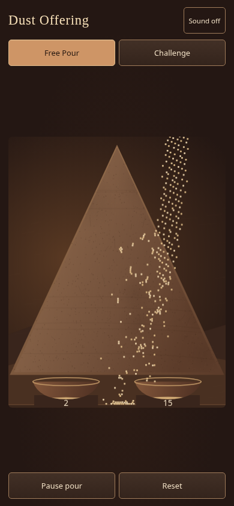
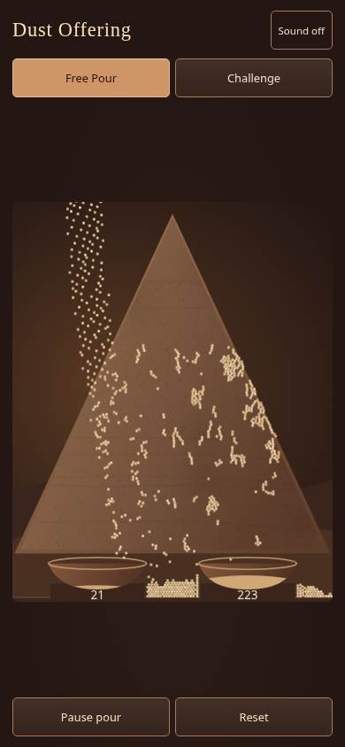

# Offscreen drifting-pour playtest

Revision 0.6.0 removes the line at the triangle's tip. Dust is born above the canvas and enters from a slowly moving, invisible opening. The opening takes one minute to sway through right, centre, left and back to centre, with smooth turnarounds. The desert palette and greasy downhill guides remain in place.

## Real-time simulated play

The scripted player watches a 45-second uninterrupted pour in actual browser time, then pauses, brushes, and lets material settle. Raw evidence: [stone-playtest-report.json](../artifacts/stone-playtest-report.json). The run used Node 24.22.1 and Linux headless Chromium 156 at 390 × 844 with emulated touch; no physical phone was used.

| Observation                           | Result                                                |
| ------------------------------------- | ----------------------------------------------------- |
| Source near 15 seconds                | x=124.00 on the right; 362 grains emitted             |
| Source near 30 seconds                | x=79.46, crossing the middle; 722 emitted             |
| Source near 45 seconds                | x=36.00 on the left; 1,083 emitted                    |
| Offscreen grains during the pour      | 14–15 at each sample, retained and accounted for      |
| Attached sand before / after brushing | 370 / 352                                             |
| Paused emission                       | 1,086 grains before and after brushing/settling       |
| After 16 seconds of settling          | 206 left + 232 right + 648 retained = 1,086           |
| Missed sand after settling            | 217 real grains resting on the ground                 |
| Source during the paused sequence     | Continued drifting to x=90.12 without emitting grains |
| Browser JavaScript errors             | None                                                  |

The moving ribbon gradually feeds different parts of the stone without shifting particles already in flight. It turns gently and leaves room to brush while the pour continues. Existing sand still gathers and releases, and missed grains remain visible. Automated play verifies these responses; real-finger feel remains for the owner's evaluation.

## Visible source sweep

These clean returning-player captures use accelerated simulation time with the first-use hint already marked as seen. [pour-sweep.json](../artifacts/pour-sweep.json) records the source positions and mass accounting for the full cycle.

| Right side, about 15 seconds                                          | Left side, about 45 seconds                                               |
| --------------------------------------------------------------------- | ------------------------------------------------------------------------- |
|  |  |

The former line is absent from the stone's tip. Browser checks compare that region with the bare cached stone and verify that new grains begin wholly above the canvas before entering view. Other captures show [crossing the middle](../artifacts/pour-centre.png) and [returning after a full cycle](../artifacts/pour-return.png).

## Challenge, guidance and load

The unattended `stone-offering-v4` challenge emits all 960 grains in 40.01 real seconds. After settling it finishes with 134 left, 228 right, 199 on the ground and 399 above the bowls, scoring 377. This checks completion and conservation, rather than an optimized score. Earlier scores remain isolated under their previous identifiers.

The two-finger phase still leaves independent grease marks, with no connecting coating between them. Two extra passes raise the left trace from strength 0.956 to 2.483; six seconds later it falls to 1.230. In the isolated seven-grain guide control, mean position moves from (70,80) to (86.88,139.54) in four seconds, with all grains still loose.

The deliberately pinned 6,000-grain fixture averages 19.89 ms per frame (about 50 FPS), with 33.4 ms at the 95th percentile. A brush sequence takes 68.3 ms and releases 46 grains without losing material. This is a cloud-machine load check, not a physical-device benchmark.

## Verification and reproduction

All 42 numerical/unit tests and 21 browser scenarios pass. Three desktop duplicates of touch-only cases are skipped. New coverage verifies actual spawn/entry positions, arrivals from both sides, bounded smooth motion, a stable starting phase during challenge preparation, drift during paused emission, hidden/resize/reset recovery, no visible marker, seeded replay including source state, and full supply. Existing sand, grease, multi-touch, pile and challenge checks remain.

```sh
npm run check
npm run test:physics
PLAYWRIGHT_CHROMIUM_EXECUTABLE=/usr/bin/chromium npm run test:browser
```

With Vite running, `npm run playtest` refreshes the real-time evidence and takes about two and a half minutes. The source browser check saves fresh right/left screenshots in the transient report. Fixed-source material evidence is retained in [archive/stone-v3/](archive/stone-v3/playtest.md), and the earlier palette review remains in [visual-style.md](visual-style.md).
