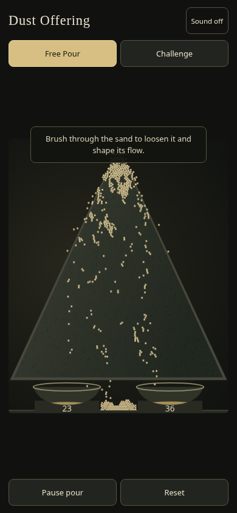

# Slow sand-on-stone playtest

The original prototype was too fast and stressful. This revision replaces its drawn barriers with slow, adhesive sand on a textured stone triangle. There is one action: brush existing material with a finger, pen or mouse. The source and bowl mouths are protected, while missed sand remains visible on the ground. Free Pour is the default; Pause pour only stops new emission, and Reset clears all material.

## Pace and shaping

Maximum grain speed is 16 units/s instead of 78; the source emits 24 grains/s instead of 120. Gravity is reduced from 160 to 12 units/s², launch speed from 22 to 3, and sideways launch from ±4 to ±0.65. The 8-unit finger footprint is larger than the old eraser and has no tool toggle. Brush release is immediate, but gravity, settling, and reattachment are deliberately slow.

Some sand stays lightly attached to bare stone. Grains in sustained contact with existing deposits bond much more readily. Those same physical circles deflect later arrivals. Brushing pushes sand aside, breaks attachments and releases dependent material outside the immediate finger footprint. Released material has a 2.5-second reattachment cooldown, giving a cleared path time to flow. Unrelated bottom piles stay asleep until actual falling grains disturb them.

## Real-time simulated play

Current evidence: [stone-playtest-report.json](../artifacts/stone-playtest-report.json). The player waits 25 real seconds for material to gather, pauses the pour, makes one slow stroke from (78,28) to (90,115), and then watches it settle for 16 seconds. This uses actual elapsed browser time, not an accelerated frame clock.

| Observation                                           | Result                                                                   |
| ----------------------------------------------------- | ------------------------------------------------------------------------ |
| Before brushing                                       | 204 attached grains: 42 on stone, 162 attached to sand                   |
| After the slow stroke                                 | 153 attached grains; material released and redistributed                 |
| Already-resting ground grains before / after brushing | 62 / 62, undisturbed by the stroke above                                 |
| After settling                                        | 260 attached grains; 166 missed grains resting on the ground             |
| Paused supply                                         | 605 emitted before/after the paused sequence, with no new grain emission |
| Retained accounting after settling                    | 82 left + 89 right + 434 retained = 605                                  |
| Browser JavaScript errors                             | None                                                                     |




The slow source leaves time to watch a deposit form. A stroke changes actual material without leaving a solid drawn line, and the released grains remain visible as they move or settle. The absence of tool switching and the stable ground piles support the intended quieter interaction. Automated play can verify these responses; whether the pace feels relaxing under a real thumb still needs the owner's evaluation.

## Optional challenge and limits

Challenge remains optional with no countdown or time penalty. It uses a new identifier, `stone-offering-v1`, so previous bests stay separate. The lower source rate produces a 960-grain supply with targets 360 / 600. Settling and rescue time is additional, and Finish has an 18-second fallback after exhaustion or the latest stroke.

The real-time player emitted all 960 grains in 40.01 seconds while making three short source-clearing strokes. That run finished with 109 left, 134 right, 258 on the ground and 459 still above the bowls, scoring 253. This was an interaction/conservation check rather than an optimized score attempt. Persistent attachments are part of the new material model, so old v2 score expectations no longer apply.

The full-face stress fixture retains 6,000 grains. On this cloud machine, its mean frame was 18.76 ms (about 53 FPS), with 33.4 ms at the 95th percentile. A direct brush pointer sequence took 64.5 ms and released 46 of those grains without losing mass. The cap includes material on the stone and on the ground. A full tray pauses the source; Reset starts a fresh pour. No retained grain is discarded for performance.

## Verification and reproduction

Testing used Node 24.22.1 and Linux headless Chromium 156, with a 390 × 844 emulated-touch viewport and a 1280 × 800 desktop viewport. Layouts also cover 320 × 568, 360 × 640, 768 × 1024 and 844 × 390. No physical phone, stylus, speaker or human participant was available.

The numerical suite covers slow speed, weak/strong adhesion, dependent release, displacement without creation/deletion, blank-stone strokes leaving future flow unchanged, contact deflection, persistent ground piles, sleeping/waking, blocked/paused/capped emission, collection, seeded replay, new scoring and isolated best/share data. Browser checks cover single-action mouse/touch strokes, capture cancellation, gradual accumulation, the optional full challenge, failed sharing/storage, sound opt-in/mute, reset/mode changes, resize/rotation, hidden recovery and protected source/bowls.

```sh
npm ci
npm run check
npm run test:physics
npx playwright install chromium
npm run test:browser
```

For real-time simulated play, run `npm run dev`, then `npm run playtest` in another terminal. It takes roughly two minutes. `npm run playtest -- --stress-only` remeasures the retained face while preserving the full-run report. A system Chromium can be selected with `PLAYWRIGHT_CHROMIUM_EXECUTABLE=/usr/bin/chromium`.

Next human prompt: **“Let some sand gather, then brush it and watch where it goes.”** Check whether the pace is now calm enough, whether the material feels like sand on stone, and whether brushing feels predictable. The remaining tuning priorities are adhesion strength, brush width/push, reattachment delay, and large-pile response on actual phones.
