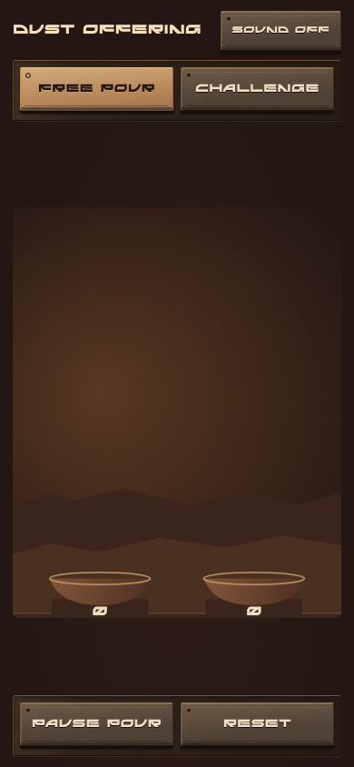
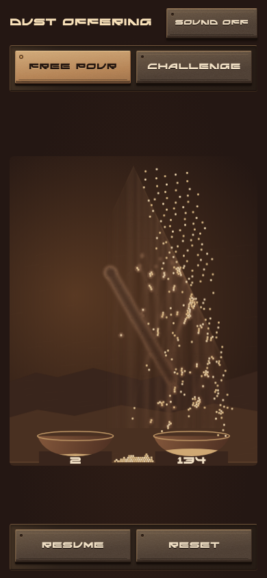
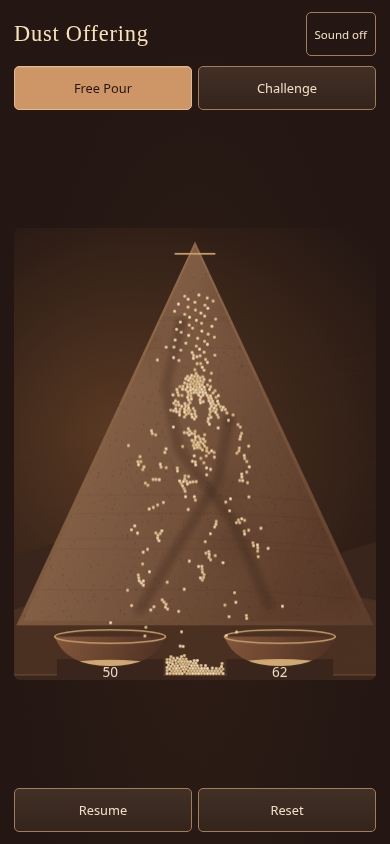
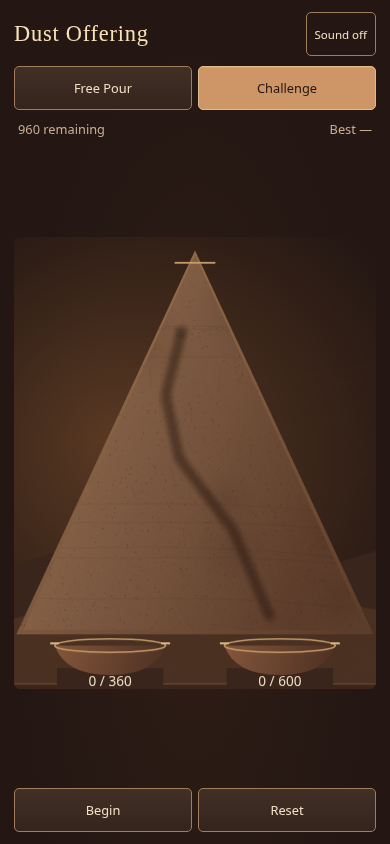
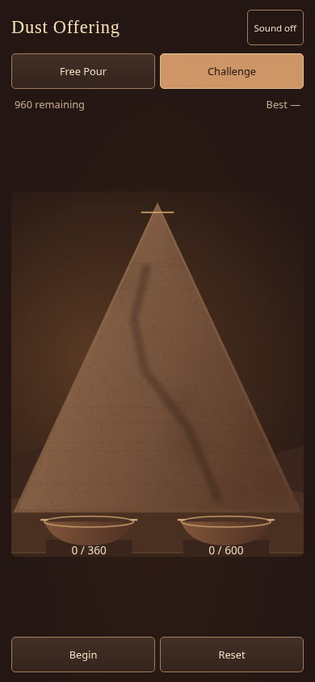

# Fringe lettering and desert hardware — revision 0.9.0

The owner's supplied FringeV2 font now covers all game text: the title, controls, notices, challenge HUD, results, copy field and Canvas bowl counts. A fresh visit opens directly into Free Pour, with the hidden stone and falling dust unobstructed. The former explanation box, saved dismissal state and pointer dismissal callback have been removed. The accessible canvas action description remains.

## Typeface and controls

The unmodified [FringeV2.otf](../src/assets/fonts/FringeV2.otf) is stored locally, registered in CSS as Fringe and preloaded by the HTML. Vite produces a hashed asset for both references. The renderer reads the canvas's inherited CSS font family, keeping the interface and game text consistent. No external font service is used. Wide lettering needs deliberate space: counts have a maximum drawing width, the full-tray notice uses two lines, and landscape reserves a wider control column.

The controls are sand-blasted mechanical cassette-futurism hardware in the established desert palette. Each key has a warm worn metal face, shallow scratches, static fine grit, a physical bevel and a dark lower recess. Mode and pour controls sit in metal housings. Selected keys use ochre faces and recessed amber indicators. A press lowers the key and changes its shadow; reduced motion retains the shadow feedback without movement. Keyboard focus remains an obvious outlined ring. Targets are 48 pixels high, with a 44-pixel sound control.

The small procedural [button-grit.svg](../src/assets/button-grit.svg) adds texture without animation or a decorative particle system. CSS owns all material layers and states. No extra lore glyphs, fake serial labels or interface controls were added. Grain physics, persistent discovery, six-second grease decay and challenge `stone-offering-v6` retain the 0.8.0 tuning.

## Current visual review

Evidence: [review.json](../artifacts/fringe-controls/review.json). The review used headless Chromium 156 with emulated touch and accelerated fixed simulation time, across 390 × 844, 320 × 568, 844 × 390 and 1280 × 800. It verified the actual loaded font, Canvas font selection, result typography, no initial hint, no document overflow, label bounds, touch targets and a complete 960-grain challenge. No physical phone was used.

| Direct entry                                                                                                       | Pour and brushing                                                                                   |
| ------------------------------------------------------------------------------------------------------------------ | --------------------------------------------------------------------------------------------------- |
|  |  |

Additional captures: [narrow phone](../artifacts/fringe-controls/narrow.png), [landscape](../artifacts/fringe-controls/landscape.png), [desktop](../artifacts/fringe-controls/desktop.png), [keyboard focus](../artifacts/fringe-controls/keyboard-focus.png) and [results](../artifacts/fringe-controls/result.png).

The existing 52 numerical/unit checks and 27 browser scenarios remain the release checks. The visual review checks this interface pass; the unchanged 0.8.0 material and real-time load evidence remains in [playtest.md](playtest.md).

# Desert dusk — revision 0.5.0 baseline

> Historical appearance baseline for revision 0.5.0. Its palette and Fringe references still ground the current direction; the interface has since changed.

The owner's direction is brown, umber, dusk orange and sand: dust crossing the desert, a mysterious old stone triangle, and greasy finger marks in the sand resting on it. This pass changes rendering and interface styling, retaining the measured `stone-offering-v3` physical model and saved-score namespace.

## References and interpretation

The [Fringe Places and Environments](https://chatgpt.com/space/page_329f295dd5588191af8b0effb8cd9ec6) reference describes Skarem's Scablands as harsh terrain with geological channels, artifact hunters and buried brember. The [Duzi tales](https://chatgpt.com/space/page_375068bb7c508191931b49b0698de256), including Loot Eater and The Augurbox Expedition, ground the old-artifact setting. The [Fringe Art and Visual Reference](https://chatgpt.com/space/page_72c0b844e9148191b14dcdffba075c12) calls for legible silhouettes, restrained colors and wear that follows an object's history. The [Pyramid Order](https://chatgpt.com/space/page_739e2a9e65cc8191a41bdd629ed27b07) remains the game's affiliation anchor.

The warm palette and grease interpretation come from the owner's direction. The procedural stone, low eroded shelves, mineral seams, dust streaks and clay vessels are game artwork. No source illustration, official glyph or new historical claim is introduced.

## Palette and materials

| Material      | Main colors                     | Treatment                                                                   |
| ------------- | ------------------------------- | --------------------------------------------------------------------------- |
| Dusk          | `#241713`, `#593923`            | Deep brown background and warm dust haze                                    |
| Stone         | `#8c674b`, `#73513b`, `#5c3c2a` | Worn lit edge, mineral variation, fine pits and irregular strata            |
| Finger grease | `#26160f`                       | Soft dark residue; repeated passes deepen it, decay reveals the stone again |
| Dust          | `#f0d3a1`, `#e8c68e`, `#f8e1b9` | Three pale mineral shades, selected deterministically by grain ID           |
| Vessels       | `#83573b`, `#4d2f22`, `#c39a68` | Clay body and worn ochre lip                                                |
| Controls      | `#ce9566`, `#f0dfc4`, `#a17d5b` | Dusk-orange selection, sand text, warm visible borders                      |

CSS custom properties in `src/styles.css` are the color source for both the interface and Canvas. `src/rendering/palette.js` reads the canvas tokens while cached artwork is rebuilt. Keep these tokens as six-digit hex colors because the renderer derives grease RGB and adds alpha to cached material colors. Visual seeds are separate from the simulation seed. Scenery is static; it does not add wind forces or nonphysical sand piles. Reduced motion preserves the grease feedback and physical grains.

## Visual review

Baseline evidence is [review.json](../artifacts/desert-dusk/review.json). Captures use headless Chromium 156, emulated touch and accelerated fixed simulation time. They cover 390 × 844, 320 × 568, 844 × 390 and 1280 × 800, plus the result dialog. No physical device was used.

| Layered grease                                                    | The same marks six seconds later                         |
| ----------------------------------------------------------------- | -------------------------------------------------------- |
|  |  |

At the sampled stroke point, RGB-sum brightness changes from 242 on bare stone to 205 after one pass, 163 after layering, then 196 after six seconds of fading. The underlying field falls from strength 2.524 to 1.252 during that interval. Browser regression checks verify that stronger marks darken and decay returns their color toward the original stone, including under reduced motion.

Measured solid-color contrast is 13.30:1 for primary text on the scene, 6.78:1 for selected-control text, 7.24:1 for muted text on the panel, 3.33:1 for control borders against the light end of their gradient, and 3.10:1 for the darkest grain against the lit stone tone. The final visual check also inspects these combinations in the textured artwork.

The 25-second simulated pour accounts for 600 grains: 50 left, 62 right and 488 retained. A complete challenge and result dialog are exercised, with no page errors. The existing 38 numerical/unit checks and 19 browser scenarios remain the release checks; no physical tuning changes are part of this pass.

Additional captures: [one pass](../artifacts/desert-dusk/phone-one-pass.png), [narrow phone](../artifacts/desert-dusk/narrow.png), [landscape](../artifacts/desert-dusk/landscape.png), [desktop](../artifacts/desert-dusk/desktop.png), [result dialog](../artifacts/desert-dusk/results.png).

Run `npm run check` and `npm run test:browser` to verify the build and interaction. `tests/browser/traces.spec.js` saves fresh layered-mark and triangle-edge screenshots in the transient browser report. `npm run playtest`, with Vite running, remains available to refresh the full real-time material evidence for the current package version.
